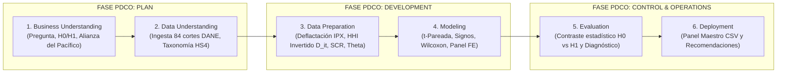
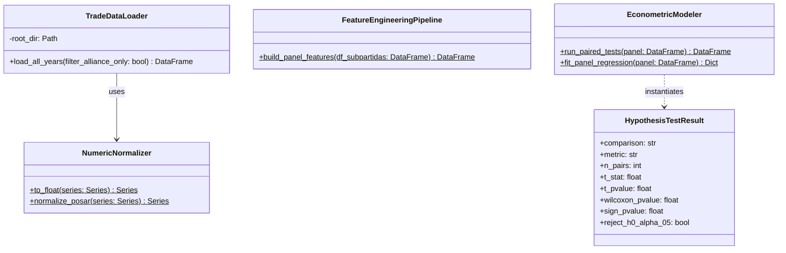

# Documento de Arquitectura de Software & Ciencia de Datos (CRISP-DM + PDCO)

**Proyecto**: Análisis Relacional de Exportaciones e Importaciones de Colombia en la Alianza del Pacífico  
**Versión**: 1.1.0  
**Fecha**: 2026-10-29  
**Fase PDCO**: `PLAN` → `DEVELOPMENT` → `CONTROL`  
**Skill Activa**: `02-architecture` & `03-development`  
**Estilo Arquitectónico**: Pipeline Modular por Capas (DAMA-BOK + CRISP-DM)  

---

## 1. Visión General y Alineación Metodológica (CRISP-DM ↔ PDCO)

El sistema integra el estándar de minería y ciencia de datos **CRISP-DM** (Cross-Industry Standard Process for Data Mining) con el marco de ingeniería de software **PDCO** y **DAMA-BOK**, garantizando reproducibilidad científica, trazabilidad documental y cumplimiento de los principios **SOLID** tanto en los módulos productivos (`src/alianza_pacifico/`) como en el cuaderno interactivo ([Analisis_exportaciones.ipynb](file:///c:/Users/ADAN/OneDrive/Documentos/datos_expo_importaciones/Analisis_exportaciones.ipynb)).

---

## 2. Decisiones de Arquitectura (ADR Resumen)

| ID | Decisión | Alternativas | Justificación |
| :--- | :--- | :--- | :--- |
| **AD-001** | Lectura nativa desde archivos `.dta` con normalización híbrida | Lectura exclusiva de `.csv` | Los `.csv` entre 2013 y 2025 presentan variaciones de codificación (`latin1` vs `utf-8-sig`), delimitadores y encabezados con espacios. El formato `.dta` permite proyección columnar rápida (`columns=...`) y normalización determinista. |
| **AD-002** | Pre-agregación en caché (`exportaciones_agregadas_2013_2025.csv`) | Recarga cruda en cada corrida del Notebook | Reduce el tiempo de ejecución del Notebook de minutos a menos de 2 segundos, manteniendo granularidad a 10 dígitos (`POSAR`), mes y socio comercial. |
| **AD-003** | Triangulación Paramétrica + No Paramétrica + Panel FE | Prueba única $t$ de Student | Las distribuciones de comercio exterior presentan asimetría positiva; combinar `ttest_rel`, `wilcoxon`, `binomtest` (Prueba de los Signos) y regresión con efectos fijos garantiza robustez estadística. |
| **AD-004** | Ingesta automatizada de Importaciones (ANDA DANE Catálogos 473 y 856) y homologación DIAN/M49 | Descarga manual y cruce sin normalizar códigos de país | DANE migró la codificación de países en 2025 de códigos DIAN (`211`, `493`, `589`) a UN M49 (`152`, `484`, `604`). El módulo `CountryCodeHomologator` construye el puente determinista hacia ISO-3 (`COD_PAI4`). |

---

## 3. Diagrama de Clases UML del Pipeline CRISP-DM

---

## 4. Validación SOLID por Componente

- **`NumericNormalizer` (SRP)**: Responsabilidad única de saneamiento tipológico y arancelario (`POSAR` a 10 dígitos).
- **`TradeDataLoader` (SRP / OCP)**: Encapsula el acceso a los 84 cortes mensuales y aplica la taxonomía arancelaria desacoplada mediante diccionarios declarativos (`TAXONOMIA_OFERTADOS`, `TAXONOMIA_DEMANDADOS`).
- **`FeatureEngineeringPipeline` (SRP)**: Implementa las ecuaciones matemáticas exactas de deflactación ($X_{i,t}^{\text{real}}$), diversificación ($D_{i,t}, N_{i,t}$) y balance relacional ($SCR_{i,t}, \theta_{i,t}$).
- **`EconometricModeler` (SRP)**: Aísla la inferencia estadística paramétrica, no paramétrica y econométrica de datos de panel.

