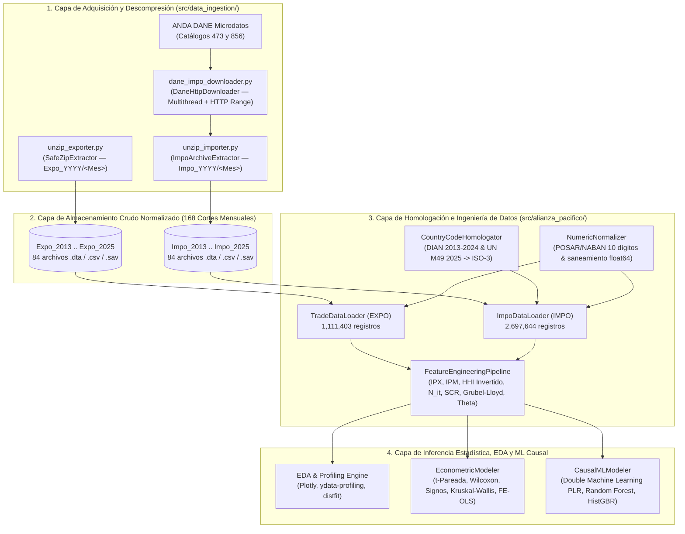

# Documentación Técnica de Desarrollo del Sistema y Catálogo de Librerías (`dev_docs`)
**Proyecto**: Sistema de Ingesta, Procesamiento DAMA-BOK y Modelado Econométrico/Causal (Alianza del Pacífico `2013–2025`)  
**Versión**: 2.0.0  
**Fecha**: 2026-10-29  
**Fase PDCO**: `PLAN` → `DEVELOPMENT` → `CONTROL` → `OPERATIONS`  
**Estándares**: SWEBOK v3, DAMA-BOK v2, Clean Code, PEP 8, Principios SOLID, Patrones GoF y GRASP  

---

## 1. Arquitectura de Ingeniería del Sistema y Ciclo de Vida (SDLC + CRISP-DM)

El sistema fue diseñado y desarrollado bajo una **Arquitectura Modular en Capas Orientada a Dominios de Datos**, desacoplando estrictamente la **adquisición e ingesta de microdatos crudos** (`src/data_ingestion/`) del **motor analítico, econométrico y de aprendizaje automático causal** (`src/alianza_pacifico/`) y de la **capa de presentación interactiva** ([`Analisis_exportaciones.ipynb`](file:///c:/Users/ADAN/OneDrive/Documentos/datos_expo_importaciones/Analisis_exportaciones.ipynb)).

### 1.1 Diagrama de Componentes y Flujo de Datos End-to-End



---

## 2. Cómo se Desarrolló el Sistema (Fases de Ingeniería)

### Fase 1: Adquisición Resiliente y Normalización Estructural de Archivos (`src/data_ingestion/`)
1. **Descarga Resiliente con Reanudación (`dane_impo_downloader.py`)**:
   - Se identificaron en el portal ANDA del DANE los recursos oficiales de importaciones para los mismos años de estudio de exportaciones (`2013`, `2014`, `2018`, `2019`, `2020`, `2024` en el Catálogo `473`, y `2025_1`/`2025_2` en el Catálogo `856`).
   - Se implementó [`DaneHttpDownloader`](file:///c:/Users/ADAN/OneDrive/Documentos/datos_expo_importaciones/src/data_ingestion/dane_impo_downloader.py) utilizando `concurrent.futures.ThreadPoolExecutor` con soporte de cabeceras HTTP `Range: bytes=...` para reanudar descargas interrumpidas, verificación de firmas mágicas ZIP y descarga fuera de la ruta sincronizada de OneDrive antes de extraer.
2. **Extracción Polimórfica en Memoria (`unzip_exporter.py` y `unzip_importer.py`)**:
   - Los paquetes anuales del DANE presentan estructuras heterogéneas según el año: entre `2013` y `2020` contienen 12 archivos `.zip` mensuales anidados (`Impo_YYYY/<Mes>.zip`); en `2024` y `2025_1` contienen carpetas directas `<Mes> YYYY/<Mes>.{csv,dta,sav}`; y en `2025_2` contienen archivos `.zip` con subcarpetas internas.
   - [`ImpoArchiveExtractor`](file:///c:/Users/ADAN/OneDrive/Documentos/datos_expo_importaciones/src/data_ingestion/unzip_importer.py) resuelve ambos casos en un solo paso mediante buffers `io.BytesIO`, extrayendo y aplanando los archivos directamente hacia `Impo_YYYY/<Mes>/<archivo>` y eliminando inmediatamente cada archivo `.zip` temporal tras validar tamaño mayor a cero.

### Fase 2: Saneamiento Tipológico, Homologación Arancelaria y de Países (`src/alianza_pacifico/`)
1. **Lectura Proyectada desde Archivos Binarios Stata (`.dta`)**:
   - En lugar de parsear archivos `.csv` de texto plano (que varían entre codificaciones `latin1` y `utf-8`, delimitadores `,` vs `;` y comillas anidadas en descripciones arancelarias), los cargadores [`TradeDataLoader`](file:///c:/Users/ADAN/OneDrive/Documentos/datos_expo_importaciones/src/alianza_pacifico/crispdm_pipeline.py) e [`ImpoDataLoader`](file:///c:/Users/ADAN/OneDrive/Documentos/datos_expo_importaciones/src/alianza_pacifico/impo_loader.py) proyectan únicamente las columnas numéricas y categóricas requeridas desde los **168 archivos `.dta`** (`84` de exportaciones y `84` de importaciones).
2. **Resolución del Cambio Metodológico DANE 2025 (`CountryCodeHomologator`)**:
   - En `2025`, el DANE migró la codificación de países en importaciones desde la tabla de 3 dígitos de la DIAN (`211` = Chile, `493` = México, `589` = Perú) hacia el estándar internacional **UN M49** (`152` = Chile, `484` = México, `604` = Perú).
   - La clase [`CountryCodeHomologator`](file:///c:/Users/ADAN/OneDrive/Documentos/datos_expo_importaciones/src/alianza_pacifico/impo_loader.py) aprende automáticamente el diccionario de correspondencia desde los microdatos de exportaciones (que contienen simultáneamente el código numérico `PAIS` y el código alfabético `COD_PAI4`) y lo aplica por régimen temporal (`DIAN` para `2013–2024` y `M49` para `2025`).

### Fase 3: Motor Econométrico, Diagnóstico Distribucional y Machine Learning Causal
1. **Integración Bilateral Exportaciones–Importaciones**:
   - El pipeline cruza los cubos `exportaciones_agregadas_2013_2025.csv` (`1,111,403` filas) e `importaciones_agregadas_2013_2025.csv` (`2,697,644` filas) a nivel de socio de la Alianza del Pacífico, mes, canasta y producto clave (`HS4`).
2. **Automatización y Pre-Ejecución Reproducible del Notebook (`update_notebook.py`)**:
   - El generador [`update_notebook.py`](file:///c:/Users/ADAN/OneDrive/Documentos/datos_expo_importaciones/src/alianza_pacifico/update_notebook.py) construye y ejecuta programáticamente todas las celdas del cuaderno [`Analisis_exportaciones.ipynb`](file:///c:/Users/ADAN/OneDrive/Documentos/datos_expo_importaciones/Analisis_exportaciones.ipynb), incrustando tablas, resultados de `distfit`, reporte `ydata-profiling`, gráficos interactivos de `Plotly` y diagnósticos de `Double Machine Learning`.

---

## 3. Principios SOLID y Patrones de Diseño Aplicados (GoF & GRASP)

| Principio / Patrón | Componente del Sistema | Implementación Concreta |
| :--- | :--- | :--- |
| **SRP (Single Responsibility Principle)** | `NumericNormalizer`, `CountryCodeHomologator`, `FeatureEngineeringPipeline`, `EconometricModeler` | Cada clase tiene una única razón de cambio: saneamiento tipológico, homologación de códigos de país, ingeniería de variables o modelado estadístico/causal. |
| **OCP (Open/Closed Principle)** | `TAXONOMIA_OFERTADOS`, `TAXONOMIA_DEMANDADOS`, `TARGET_IMPO_RESOURCES` | La taxonomía arancelaria y el catálogo de descargas están declarados en estructuras inmutables desacopladas de la lógica de agregación. |
| **ISP & DIP (Interface Segregation & Dependency Inversion)** | `PathNormalizer` (`Protocol`) en `unzip_exporter.py` | `SafeZipExtractor` depende de la abstracción `PathNormalizer` y no de una implementación concreta de sistema de archivos. |
| **GoF Strategy Pattern** | Selección de régimen de homologación (`DIAN` vs `M49`) y estimadores ML | Permite intercambiar la estrategia de homologación geográfica según el año y los aprendices base (`RandomForestRegressor` vs `HistGradientBoostingRegressor`) en el módulo DML. |
| **GoF Builder / Factory Method** | `make_markdown_cell`, `make_code_cell` en `update_notebook.py` | Encapsula la construcción paso a paso de celdas compatibles con la especificación JSON `nbformat v4`. |
| **GRASP Information Expert & High Cohesion** | `HypothesisTestResult`, `ExtractionResult` (`@dataclass(frozen=True)`) | Objetos de valor inmutables que transportan resultados verificados entre capas sin efectos secundarios. |

---

## 4. Catálogo Técnico de Librerías Utilizadas

| Librería | Versión / Módulo | Rol en la Arquitectura | Justificación Técnica y Científica |
| :--- | :--- | :--- | :--- |
| **`pandas`** | `2.3+` (`DataFrame`, `read_stata`, `pivot_table`, `groupby`) | Procesamiento tabular y agregación OLAP en memoria | Permite la lectura columnar rápida (`columns=...`) de los 168 archivos binarios `.dta` de Stata y operaciones vectorizadas de agrupación a 10 dígitos arancelarios. |
| **`numpy`** | `2.x` (`ndarray`, `linalg.lstsq`, `log`, `select`, `where`) | Álgebra lineal numérica y transformaciones vectorizadas | Soporta el cálculo matricial de Mínimos Cuadrados Ordinarios ($\hat{\beta} = (X^T X)^{-1} X^T y$), índices Herfindahl-Hirschman y transformaciones logarítmicas sin bucles en Python. |
| **`scipy`** | `1.16+` (`scipy.stats`: `ttest_rel`, `wilcoxon`, `binomtest`, `kruskal`, `shapiro`, `normaltest`, `jarque_bera`, `spearmanr`) | Inferencia estadística paramétrica y no paramétrica | Provee implementaciones exactas y asintóticas de pruebas de hipótesis emparejadas, pruebas de normalidad y correlaciones por rangos. |
| **`statsmodels`** | `0.14+` (`OLS`, `cov_type='HC3'`, diagnósticos econométricos) | Econometría de datos de panel y errores estándar robustos | Permite contrastar la significancia de los parámetros bajo heterocedasticidad de White/MacKinnon (`HC3`) y validar multicolinealidad/autocorrelación. |
| **`scikit-learn`** | `1.6+` (`RandomForestRegressor`, `HistGradientBoostingRegressor`, `Ridge`, `KFold`, `TimeSeriesSplit`, `permutation_importance`) | Machine Learning Predictivo e Inferencia Causal (*Double Machine Learning*) | Provee los algoritmos no paramétricos de ensamble de árboles utilizados en el *cross-fitting* de Neyman para **Double Machine Learning (DML)** y la evaluación predictiva fuera de muestra. |
| **`plotly`** | `6.x` (`plotly.express`, `plotly.graph_objects`, `make_subplots`) | Visualización científica interactiva en el Notebook | Genera gráficos interactivos multidimensionales (evolución bilateral $X$ vs $M$, diagramas * Treemap / Sunburst* arancelarios, superficies de diversificación y bosques de efectos causales). |
| **`distfit`** | `1.8+` (`distfit`) | Ajuste probabilístico de distribuciones teóricas en el EDA | Evalúa empíricamente qué ley de probabilidad (*Log-Normal*, *Gamma*, *Weibull*, *Pareto*, *Normal*, *t-Student*) gobierna las exportaciones, importaciones y sus transformaciones logarítmicas mediante minimización de $\text{RSS}$. |
| **`ydata-profiling`** | `4.x` (`ProfileReport`) | Auditoría automatizada de calidad de datos (DAMA-BOK Data Quality) | Genera el perfilamiento estadístico exhaustivo del panel de la Alianza del Pacífico (completitud, cardinalidad, cuantiles, asimetría, curtosis, correlaciones de Pearson/Spearman y alertas de calidad) exportado a HTML e integrado en el EDA. |
| **`matplotlib` & `seaborn`** | `3.10+` / `0.13+` | Renderizado estático de alta resolución (DPI 130) | Complementa las figuras interactivas de Plotly con paneles diagnósticos embebidos en Base64 para portabilidad universal del archivo `.ipynb` en visores estáticos (GitHub / PDF). |
| **`urllib`, `ssl`, `zipfile`, `concurrent.futures`** | Librería Estándar de Python `3.13` | Ingesta concurrente HTTP y descompresión sin dependencias externas | Garantiza portabilidad y tolerancia a fallos en la descarga y extracción de los ~4.3 GB de archivos comprimidos del DANE. |

---

## 5. Guía de Ejecución y Reproducibilidad

Para reproducir íntegramente el flujo desde la consola en la raíz del proyecto:

```powershell
# 1. Descargar paquetes oficiales de Importaciones DANE (si se requiere actualizar desde ANDA)
python -m src.data_ingestion.dane_impo_downloader

# 2. Extraer y normalizar estructura Impo_YYYY/<Mes>/
python -m src.data_ingestion.unzip_importer

# 3. Consolidar cubo agregado de Importaciones (2,697,644 registros)
python -m src.alianza_pacifico.impo_loader

# 4. Ejecutar pipeline CRISP-DM completo (Exportaciones + Importaciones + Panel + Econometría + DML Causal)
python -m src.alianza_pacifico.crispdm_pipeline

# 5. Regenerar y pre-ejecutar el Notebook interactivo con EDA (Plotly, distfit, ydata-profiling) y ML Causal
python -m src.alianza_pacifico.update_notebook
```
