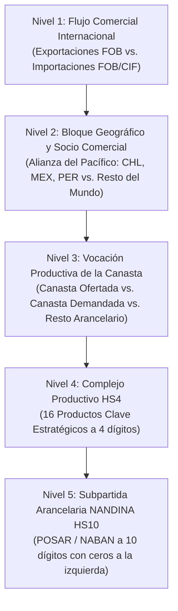

# Documentación Estadística y Metodológica Maestra
**Proyecto**: Análisis Econométrico, Estadístico y Causal del Comercio Bilateral (Exportaciones e Importaciones) de Colombia en la Alianza del Pacífico (2013–2025)  
**Versión**: 2.0.0  
**Fecha**: 2026-10-29  
**Fase PDCO**: `PLAN` → `DEVELOPMENT` → `CONTROL`  
**Estándares de Referencia**: DAMA-BOK v2, CRISP-DM 1.0, IEEE 830 / ISO 29148, SWEBOK v3, UN IMTS 2010 (*International Merchandise Trade Statistics*)  

---

## 1. Batería de Fuentes de Datos Oficiales (*Data Provenance & Lineage*)

El estudio se fundamenta exclusivamente en microdatos transaccionales oficiales de comercio exterior de Colombia, recolectados por la **Dirección de Impuestos y Aduanas Nacionales (DIAN)** a través de los registros administrativos aduaneros y validados, depurados y publicados por el **Departamento Administrativo Nacional de Estadística (DANE)** en su Archivo Nacional de Datos (**ANDA** — `microdatos.dane.gov.co`).

### 1.1 Matriz de Fuentes Primarias

| ID Fuente | Operación Estadística | Entidad Productora | Catálogo ANDA DANE | Cobertura Temporal Analizada | Cortes Mensuales | Registros Crudos Consolidados (Nivel `POSAR` 10 dígitos × País × Mes) | Artefacto Consolidado en `data/processed/` |
| :--- | :--- | :--- | :---: | :---: | :---: | :---: | :--- |
| **F-01** | **Estadísticas de Exportaciones (EXPO)** — Declaraciones de Exportación (DEX) | DANE / DIAN | Históricos `2013–2024` y `2025` | `2013`, `2014`, `2018`, `2019`, `2020`, `2024`, `2025` | **84 meses** (`7 años × 12 meses`) | **1,111,403** tuplas agregadas (todos los destinos del mundo) | [`exportaciones_agregadas_2013_2025.csv`](file:///c:/Users/ADAN/OneDrive/Documentos/datos_expo_importaciones/data/processed/exportaciones_agregadas_2013_2025.csv) |
| **F-02** | **Estadísticas de Importaciones (IMPO)** — Declaraciones de Importación (DIM) Serie Histórica | DANE / DIAN | Catálogo **473** (`DANE-DIMPE-IMPO-2012-2024`, IDs `9029`, `9030`, `10347`, `12602`, `20042`, `24390`) | `2013`, `2014`, `2018`, `2019`, `2020`, `2024` | **72 meses** (`6 años × 12 meses`) | **2,697,644** tuplas agregadas (conjuntamente con `2025`, todos los orígenes) | [`importaciones_agregadas_2013_2025.csv`](file:///c:/Users/ADAN/OneDrive/Documentos/datos_expo_importaciones/data/processed/importaciones_agregadas_2013_2025.csv) |
| **F-03** | **Estadísticas de Importaciones (IMPO)** — Serie Reciente bajo Nomenclatura UN M49 | DANE / DIAN | Catálogo **856** (`DANE-DIMPE-IMPO-2025-2026`, IDs `24417`, `24464`) | `2025` (`Enero` a `Diciembre`) | **12 meses** (`1 año × 12 meses`) | Integrado en los **2,697,644** registros de `importaciones_agregadas_2013_2025.csv` | [`importaciones_agregadas_2013_2025.csv`](file:///c:/Users/ADAN/OneDrive/Documentos/datos_expo_importaciones/data/processed/importaciones_agregadas_2013_2025.csv) |
| **F-04** | **Nomenclatura Arancelaria NANDINA / Sistema Armonizado (HS)** | Comunidad Andina / OMA / DIAN | Decreto 2153 de 2016 y Decreto 1881 de 2021 (VI y VII Enmienda del SA) | `2013–2025` | Transversal | Armonizado a 10 dígitos (`POSAR` / `NABAN`), partida `HS4` (4 dígitos) y capítulo `HS2` (2 dígitos) | Integrado en `src/alianza_pacifico/crispdm_pipeline.py` |
| **F-05** | ** Tabla de Correlación de Países DIAN ↔ UN M49 ↔ ISO 3166-1 alpha-3** | DANE / Naciones Unidas | Estándar M49 de la División de Estadística de la ONU | `2013–2024` (DIAN) vs. `2025` (M49) | Transversal | Homologación determinista a `COD_PAI4` (`CHL`, `MEX`, `PER`, y resto del mundo) | [`impo_loader.py`](file:///c:/Users/ADAN/OneDrive/Documentos/datos_expo_importaciones/src/alianza_pacifico/impo_loader.py) |

### 1.2 Bloques Temporales de Estudio (Diseño Cuasi-Experimental Longitudinal)

La selección de los **7 años** (**84 cortes mensuales**) obedece a un diseño comparativo por bloques estructurales que captura tres fases institucionales y macroeconómicas de la **Alianza del Pacífico** (Acuerdo Marco suscrito en Paranal, Chile, en junio de 2012, y Protocolo Adicional de desgravación del $92\%$ del universo arancelario en vigor desde mayo de 2016):

1. **$P_1$ — Pre-Consolidación Arancelaria (`2013–2014`, $24\text{ meses}$)**: Línea base posterior a las Cumbres de Lima y Paranal (`2011–2012`), previa a la entrada en vigor plena del Protocolo Adicional de desgravación acumulada.
2. **$P_2$ — Consolidación Post-Protocolo y Choque Pandémico (`2018–2020`, $36\text{ meses}$)**: Fase de operación arancelaria madura tras el protocolo `2015–2016`, incluyendo la contracción de comercio global por COVID-19 en `2020`.
3. **$P_3$ — Madurez Reciente y Reconfiguración Regional (`2024–2025`, $24\text{ meses}$)**: Fase de pospandemia, relocalización de cadenas de suministro (*nearshoring*) y estabilización de preferencias arancelarias intrabloque.

---

## 2. Taxonomía del Dato y Clasificación Arancelaria

### 2.1 Jerarquía Dimensional del Dato

El modelo de datos sigue una taxonomía jerárquica de cinco niveles conforme a **DAMA-BOK**:

### 2.2 Taxonomía Arancelaria de Productos Clave (`HS4` $\rightarrow$ Complejo Productivo)

#### A. Canasta Ofertada (Vocación Exportadora de Colombia hacia la Alianza del Pacífico)

| Código `HS4` | Capítulo `HS2` | Nombre del Complejo Productivo (`producto_clave`) | Naturaleza Económica | Rol en la Estructura Exportadora |
| :---: | :---: | :--- | :--- | :--- |
| **`2701`** | `27` | Hullas, briquetas y combustibles sólidos similares | Minero-energético primario | Producto ancla energético hacia Chile y México |
| **`2709`** | `27` | Aceites crudos de petróleo | Minero-energético primario | Flujo energético de alto volumen unitario |
| **`2710`** | `27` | Aceites de petróleo (excepto crudos) | Refinación energética | Derivados y combustibles líquidos de refinación |
| **`2603`** | `26` | Minerales de cobre y sus concentrados | Minería metálica | Insumo metalúrgico para fundiciones regionales |
| **`2616`** / **`7108`** | `26` / `71` | Minerales de metales preciosos (oro y cobre) | Minería de metales preciosos | Reserva de valor y flujo metalúrgico especializado |
| **`1511`** | `15` | Aceite de palma y sus fracciones | Agroindustria oleaginosa | Agroexportación bandera con encadenamiento regional |
| **`3808`** | `38` | Insecticidas, fungicidas, herbicidas y similares | Industria química especializada | Manufactura química de media-alta tecnología |
| **`3304`** | `33` | Preparaciones de belleza, maquillaje y cuidado de la piel | Industria cosmética | Manufactura diferenciada de alto valor por kilogramo |

#### B. Canasta Demandada (Vocación Importadora de Colombia desde la Alianza del Pacífico y Referencia Intraindustrial)

| Código `HS4` | Capítulo `HS2` | Nombre del Complejo Productivo (`producto_clave`) | Naturaleza Económica | País Proveedor Predominante en la Alianza |
| :---: | :---: | :--- | :--- | :--- |
| **`8703`** / **`8704`** | `87` | Automóviles de turismo y vehículos de transporte | Industria automotriz | México (`MEX`) |
| **`8528`** | `85` | Monitores, proyectores y receptores de televisión | Electrónica de consumo | México (`MEX`) |
| **`7408`** | `74` | Alambre de cobre | Metalurgia intermedia de cobre | Perú (`PER`) y Chile (`CHL`) |
| **`3004`** | `30` | Medicamentos dosificados | Industria farmacéutica | México (`MEX`) y Chile (`CHL`) |
| **`0808`** | `08` | Manzanas, peras y membrillos frescos | Agroindustria frutícola de clima templado | Chile (`CHL`) |
| **`8471`** | `84` | Máquinas automáticas para procesamiento de datos | Bienes de capital tecnológicos | México (`MEX`) |
| **`7304`** / **`7306`** | `73` | Tubos y perfiles huecos de hierro o acero | Siderurgia y bienes intermedios | México (`MEX`) |
| **`8701`** | `87` | Tractores | Maquinaria agrícola y de transporte | México (`MEX`) |

---

## 3. Diccionario de Datos Maestro (*Data Dictionary*)

### 3.1 Variables de Entrada en Microdatos Crudos (`Expo_YYYY` e `Impo_YYYY`)

| Nombre Variable Cruda | Operación | Tipo Físico | Escala Stevens | Descripción Técnica | Regla de Homologación / Transformación |
| :--- | :---: | :---: | :---: | :--- | :--- |
| `FECH` | EXPO / IMPO | `int64` / `str` | Intervalo | Periodo del registro administrativo en formato `AAMM` (ej. `1301` = Enero 2013, `2512` = Diciembre 2025). | `anio` derivado de la carpeta anual; `mes = (FECH % 100)` acotado a $[1, 12]$. |
| `COD_PAI4` | EXPO | `str(3)` | Nominal | Código ISO 3166-1 alpha-3 del país de destino de la exportación (`CHL`, `MEX`, `PER`). | Estandarizado en mayúsculas sin espacios (`str.strip().str.upper()`). |
| `PAISGEN` | IMPO | `int` / `str(3)` | Nominal | País de origen de la mercancía importada. En `2013–2024` usa código DIAN (`211`=CHL, `493`=MEX, `589`=PER); en `2025` usa código ONU M49 (`152`=CHL, `484`=MEX, `604`=PER). | Homologado a `COD_PAI4` mediante [`CountryCodeHomologator`](file:///c:/Users/ADAN/OneDrive/Documentos/datos_expo_importaciones/src/alianza_pacifico/impo_loader.py). |
| `POSAR` / `NABAN` | EXPO / IMPO | `str(10)` | Nominal | Subpartida arancelaria NANDINA a 10 dígitos (`POSAR` en exportaciones, `NABAN` en importaciones). | Saneamiento de sufijos `.0` y relleno con ceros a la izquierda (`zfill(10)`). |
| `FOBDOL` / `VAFODO` | EXPO / IMPO | `float64` | Razón | Valor FOB (*Free On Board*) en dólares estadounidenses (USD corrientes). | Normalización de separadores decimales `,` y de miles `.` a `float64 >= 0`. |
| `FOBPES` | EXPO | `float64` | Razón | Valor FOB en pesos colombianos (COP corrientes). | En IMPO se estima proporcionalmente como $\text{VACIP} \times (\text{VAFODO}/\text{VACID})$. |
| `VACID` | IMPO | `float64` | Razón | Valor CIF (*Cost, Insurance and Freight*) en dólares estadounidenses (USD corrientes). | Exclusivo de importaciones; incluye fletes (`FLETE`) y seguros (`SEGUROS`). |
| `VACIP` | IMPO | `float64` | Razón | Valor CIF en pesos colombianos (COP corrientes). | Normalizado a `float64 >= 0`. |
| `PNK` | EXPO / IMPO | `float64` | Razón | Peso neto en kilogramos ($\text{kg}$), excluyendo empaques y envases. | Base para el cálculo de valores unitarios ($\text{USD/kg}$) e índices de precios implícitos. |
| `CANTI` / `CANU` | EXPO / IMPO | `float64` | Razón | Cantidad de unidades físicas comerciales según unidad arancelaria (`UNID` / `CODA`). | Agregado por suma simple dentro de cada subpartida `POSAR` de 10 dígitos. |

### 3.2 Variables del Panel Econométrico y Causal (`panel_alianza_pacifico_2013_2025.csv`)

| Nombre Variable | Símbolo Matemático | Tipo | Escala | Dominio Teórico | Unidad | Definición Operacional |
| :--- | :---: | :---: | :---: | :---: | :---: | :--- |
| `anio` | $t_{\text{año}}$ | `int64` | Intervalo | $\{2013, 2014, 2018, 2019, 2020, 2024, 2025\}$ | Año calendario | Año de proceso de la declaración aduanera. |
| `mes` | $t_{\text{mes}}$ | `int64` | Intervalo | $\{1, 2, \dots, 12\}$ | Mes del año | Mes de proceso de la declaración aduanera. |
| `fecha` | $t$ | `datetime64` | Intervalo | `2013-01-01` a `2025-12-01` | Fecha mensual | Índice temporal mensual (`YYYY-MM-01`). |
| `COD_PAI4` | $i$ | `str(3)` | Nominal | $\{\text{CHL}, \text{MEX}, \text{PER}\}$ | Código ISO-3 | Identificador del socio comercial de la Alianza del Pacífico. |
| `bloque_temporal` | $B_t$ | `str` | Ordinal | $\{P_1, P_2, P_3\}$ | Bloque histórico | Periodo institucional de desarrollo de la Alianza del Pacífico. |
| `tipo_canasta` | $c$ | `str` | Nominal | $\{\text{Ofertada}, \text{Demandada}, \text{Resto}\}$ | Categoría | Clasificación vocacional según partida `HS4`. |
| `fob_usd` | $X_{i,c,t}^{\text{nom}}$ | `float64` | Razón | $[0, +\infty)$ | USD corrientes | Valor FOB nominal exportado en el corte $(i, c, t)$. |
| `impo_fob_usd` | $M_{i,c,t}^{\text{nom}}$ | `float64` | Razón | $[0, +\infty)$ | USD corrientes | Valor FOB nominal importado desde el socio $i$ en la canasta $c$ y mes $t$. |
| `impo_cif_usd` | $M_{i,c,t}^{\text{CIF}}$ | `float64` | Razón | $[0, +\infty)$ | USD corrientes | Valor CIF nominal importado desde el socio $i$ en la canasta $c$ y mes $t$. |
| `ipx_promedio` | $\text{IPX}_{i,c,t}$ | `float64` | Razón | $[50, 250]$ | Índice ($2013=100$) | Índice de precios implícito de exportación por capítulo `HS2` (acotado para robustez). |
| `ipm_promedio` | $\text{IPM}_{i,c,t}$ | `float64` | Razón | $[50, 250]$ | Índice ($2013=100$) | Índice de precios implícito de importación por capítulo `HS2` (acotado para robustez). |
| `exportaciones_reales` | $X_{i,c,t}^{\text{real}}$ | `float64` | Razón | $[0, +\infty)$ | USD constantes 2013 | Exportaciones FOB deflactadas: $(X_{i,c,t}^{\text{nom}} / \text{IPX}_{i,c,t}) \times 100$. |
| `importaciones_reales` | $M_{i,c,t}^{\text{real}}$ | `float64` | Razón | $[0, +\infty)$ | USD constantes 2013 | Importaciones FOB deflactadas: $(M_{i,c,t}^{\text{nom}} / \text{IPM}_{i,c,t}) \times 100$. |
| `n_subpartidas_activas` | $N_{i,c,t}^{X}$ | `int64` | Razón (Discreta) | $\mathbb{Z}_{\ge 0}$ | Conteo de códigos HS10 | **Margen extensivo exportador**: número de subpartidas a 10 dígitos con $X_{k,i,c,t} > 0$. |
| `impo_n_subpartidas` | $N_{i,c,t}^{M}$ | `int64` | Razón (Discreta) | $\mathbb{Z}_{\ge 0}$ | Conteo de códigos HS10 | **Margen extensivo importador**: número de subpartidas a 10 dígitos con $M_{k,i,c,t} > 0$. |
| `hhi_invertido` | $D_{i,c,t}^{X}$ | `float64` | Razón | $[0, 1)$ | Adimensional | **Diversificación exportadora**: $1 - \sum_{k} (X_{k,i,c,t} / X_{i,c,t})^2$. |
| `impo_hhi_invertido` | $D_{i,c,t}^{M}$ | `float64` | Razón | $[0, 1)$ | Adimensional | **Diversificación importadora**: $1 - \sum_{k} (M_{k,i,c,t} / M_{i,c,t})^2$. |
| `scr` | $SCR_{i,t}^{\text{ref}}$ | `float64` | Intervalo/Razón | $[-1, +1]$ | Adimensional | Saldo comercial relativo interno entre Canasta Ofertada y Demandada de referencia. |
| `scr_bilateral` | $SCR_{i,c,t}^{\text{bil}}$ | `float64` | Intervalo/Razón | $[-1, +1]$ | Adimensional | **Saldo Comercial Relativo Bilateral Real**: $(X_{i,c,t}^{\text{real}} - M_{i,c,t}^{\text{real}}) / (X_{i,c,t}^{\text{real}} + M_{i,c,t}^{\text{real}})$. |
| `grubel_lloyd` | $GL_{i,c,t}$ | `float64` | Razón | $[0, 1]$ | Adimensional | **Índice de Grubel-Lloyd Intraindustrial**: $1 - |SCR_{i,c,t}^{\text{bil}}|$. |
| `theta` | $\theta_{i,t}^{\text{ref}}$ | `float64` | Intervalo | $(-\infty, +\infty)$ | Log-ratio | Razón logarítmica suavizada entre Canasta Ofertada y Demandada de referencia. |
| `theta_bilateral` | $\theta_{i,c,t}^{\text{bil}}$ | `float64` | Intervalo | $(-\infty, +\infty)$ | Log-ratio | **Razón Logarítmica Bilateral X/M**: $\ln((X_{i,c,t}^{\text{real}} + 1) / (M_{i,c,t}^{\text{real}} + 1))$. |

---

## 4. Variables Buscadas y Formulación Matemática Exacta

El problema de investigación busca cuantificar cómo la **variedad arancelaria** (margen extensivo $N_{i,c,t}$), la **equidad de participación** (índice de diversificación $D_{i,c,t}$) y la **posición competitiva frente a las importaciones** ($\theta_{i,c,t}, SCR_{i,c,t}$) determinan el **crecimiento real de las exportaciones** ($X_{i,c,t}^{\text{real}}$).

### 4.1 Deflactación por Valor Unitario Implícito ($\text{IPX}_{h,t}$ e $\text{IPM}_{h,t}$)

Para aislar el crecimiento en volumen real de la inflación en dólares de las materias primas, se calcula el valor unitario anual por capítulo arancelario $h \in \text{HS2}$:

$$UV_{h,t}^{X} = \frac{\sum_{k \in h} X_{k,t}^{\text{FOB\_USD}}}{\sum_{k \in h} \text{PNK}_{k,t}^{X}}, \qquad \text{IPX}_{h,t} = \text{clip}\left( \frac{UV_{h,t}^{X}}{UV_{h,2013}^{X}} \times 100, \; 50, \; 250 \right)$$

El acotamiento (*winsorizing* estructural en $[50, 250]$) previene que variaciones extremas de peso en partidas heterogéneas distorsionen el deflactor. Así, el flujo real expresado en dólares constantes de 2013 es:

$$X_{i,c,t}^{\text{real}} = \sum_{k \in (i,c)} \frac{X_{k,i,c,t}^{\text{FOB\_USD}}}{\text{IPX}_{h(k),t}} \times 100, \qquad M_{i,c,t}^{\text{real}} = \sum_{k \in (i,c)} \frac{M_{k,i,c,t}^{\text{FOB\_USD}}}{\text{IPM}_{h(k),t}} \times 100$$

### 4.2 Descomposición de Márgenes Comerciales (Hummels & Klenow, 2005)

- **Margen Extensivo ($N_{i,c,t}^{X}$)**: Cardinalidad del conjunto de subpartidas arancelarias activas:
  $$N_{i,c,t}^{X} = \left| \left\{ k \in \text{POSAR}_{10} : X_{k,i,c,t}^{\text{FOB\_USD}} > 0 \right\} \right|$$
- **Margen Intensivo Promedio ($\bar{x}_{i,c,t}^{\text{real}}$)**: Valor real exportado por subpartida activa:
  $$\bar{x}_{i,c,t}^{\text{real}} = \frac{X_{i,c,t}^{\text{real}}}{N_{i,c,t}^{X}} \implies \ln\left(X_{i,c,t}^{\text{real}}\right) = \ln\left(N_{i,c,t}^{X}\right) + \ln\left(\bar{x}_{i,c,t}^{\text{real}}\right)$$
- **Índice de Diversificación de Hirschman-Herfindahl Invertido ($D_{i,c,t}^{X}$)**:
  $$s_{k,i,c,t} = \frac{X_{k,i,c,t}^{\text{FOB\_USD}}}{\sum_{j \in (i,c)} X_{j,i,c,t}^{\text{FOB\_USD}}}, \qquad D_{i,c,t}^{X} = 1 - \sum_{k \in (i,c)} s_{k,i,c,t}^2$$
  Cuando una sola subpartida concentra el $100\%$ del comercio, $D_{i,c,t}^{X} = 0$ (monocultivo exportador). Cuando $N$ subpartidas participan equitativamente ($s_k = 1/N$), $D_{i,c,t}^{X} = 1 - 1/N \to 1$.

---

## 5. Metodología Estadística y Casos de Uso Paramétricos vs. No Paramétricos

### 5.1 Diagnóstico Distribucional y Ajuste Probabilístico (`distfit`)

En datos de comercio internacional desagregados (ley de gravedad y modelos de firmas heterogéneas de Melitz, 2003), los valores monetarios $X_{i,c,t}^{\text{real}}$ y $M_{i,c,t}^{\text{real}}$ exhiben **asimetría positiva severa** ($\gamma_1 \gg 0$) y **colas pesadas** (*heavy tails*, curtosis excesiva $\gamma_2 \gg 0$).

Mediante ajuste paramétrico de densidades por máxima verosimilitud (`distfit`, evaluando familias *Log-Normal*, *Gamma*, *Weibull*, *Pareto*, *Exponencial*, *Beta*, *Normal* y *t-Student* mediante suma de cuadrados residuales $\text{RSS}$ y criterio de información de Akaike $\text{AIC}$):
1. **En niveles ($X_{i,c,t}^{\text{real}}, M_{i,c,t}^{\text{real}}$)**: Se rechaza la normalidad en las pruebas de **Shapiro-Wilk** ($W$, $p < 10^{-10}$), **D'Agostino-Pearson** ($K^2$, $p < 10^{-10}$) y **Jarque-Bera** ($JB$, $p < 10^{-10}$). Las familias de mejor ajuste son **Log-Normal**, **Gamma** y **Weibull**.
2. **En transformación logarítmica ($\ln X_{i,c,t}^{\text{real}}$) y diferencias pareadas ($\Delta Y_{i,m,c}$)**: La asimetría se reduce drásticamente, aproximándose a familias simétricas (*Normal* / *t-Student* / *Log-Gamma*), habilitando el uso conjunto de inferencia paramétrica (bajo el Teorema Central del Límite con $N = 108$ pares) y no paramétrica libre de distribución.

### 5.2 Matriz de Casos de Uso: Pruebas Paramétricas vs. No Paramétricas

| Caso de Uso Analítico | Prueba Paramétrica Aplicada | Supuestos Requeridos | Prueba No Paramétrica Homóloga | Ventaja de la Prueba No Paramétrica en Comercio Exterior | Regla de Decisión Triangulada |
| :--- | :--- | :--- | :--- | :--- | :--- |
| **UC-EST-01: Cambio estructural entre bloques temporales ($P_1 \to P_2$, $P_2 \to P_3$, $P_1 \to P_3$) sobre unidades emparejadas `(país, mes, canasta)` ($N=108$)** | **Prueba $t$-Student para Muestras Emparejadas** (`ttest_rel`): $$t = \frac{\bar{d}}{s_d / \sqrt{n}} \sim t_{n-1}$$ | Normalidad aproximada de las diferencias $d_j = Y_{j,\text{post}} - Y_{j,\text{pre}}$ o $n \ge 30$ vía TCL; ausencia de outliers extremos que dominen $\bar{d}$. | **1. Prueba de Rangos con Signo de Wilcoxon** (`wilcoxon`): $$W = \sum_{j=1}^{n} \text{sgn}(d_j) R_{|d_j|}$$ **2. Prueba Exacta de los Signos** (`binomtest`): $$S^+ = \sum \mathbb{I}(d_j > 0) \sim \text{Bin}(n_{\neq 0}, 0.5)$$ | Invariante ante choques extremos en precios de petróleo/carbón (`2701`, `2709`); evalúa el cambio en la **mediana** ($\Delta \tilde{Y}$) y la **proporción de meses con crecimiento real positivo** ($S^+ / n_{\neq 0}$). | Se declara cambio estructural robusto si $p_{t\text{-test}} < 0.05$ **y** al menos una prueba no paramétrica ($p_{\text{Wilcoxon}} < 0.05$ o $p_{\text{Signos}} < 0.05$) rechaza $H_0$. |
| **UC-EST-02: Comparación transversal entre los 3 países socios (`CHL`, `MEX`, `PER`) o entre las 3 canastas** | **ANOVA de una vía ($F$ de Fisher) / ANOVA de Welch** (`f_oneway`) | Normalidad intragrupo y homocedasticidad (verificada con prueba de Levene). | **Prueba de Kruskal-Wallis por Rangos ($H$)** (`kruskal`): $$H = \frac{12}{N(N+1)}\sum_{g=1}^{G} \frac{R_g^2}{n_g} - 3(N+1)$$ | Robusta frente a la marcada diferencia de escala entre México (mayor volumen industrial) y Perú/Chile, y frente a heterocedasticidad entre canastas. | Si Levene rechaza homocedasticidad ($p < 0.05$), prevalece Kruskal-Wallis + comparaciones post-hoc de Mann-Whitney con corrección de Holm-Bonferroni. |
| **UC-EST-03: Asociación monótona vs. lineal entre Diversificación ($D_{i,t}, N_{i,t}$), Balance ($\theta_{i,t}$) y Exportaciones Reales ($X_{i,t}^{\text{real}}$)** | **Correlación Lineal de Pearson ($r$)** (`pearsonr`): $$r = \frac{\text{Cov}(X,Y)}{\sigma_X \sigma_Y}$$ | Linealidad bivariada y distribución elíptica sin apalancamiento extremo. | **Correlación de Rangos de Spearman ($\rho_s$)** (`spearmanr`) y **Tau de Kendall ($\tau_b$)** | Captura relaciones monótonas no lineales (ej. rendimientos decrecientes o exponenciales del número de subpartidas sobre el valor exportado). | Reportar matriz dual $(r_{\text{Pearson}}, \rho_{\text{Spearman}})$ con sus respectivos valores-$p$ bilaterales. |

### 5.3 Modelado Econométrico de Panel y Machine Learning Causal (*Double Machine Learning*)

Para estimar el efecto causal de la diversificación ($D_{i,c,t}^{X}$), el margen extensivo ($\ln N_{i,c,t}^{X}$) y la cobertura comercial bilateral ($\theta_{i,c,t}^{\text{bil}}$) sobre el crecimiento real exportador ($\ln X_{i,c,t}^{\text{real}}$), se implementan tres niveles de modelado complementarios:

#### Nivel 1: Modelo Econométrico de Datos de Panel con Efectos Fijos (FE-OLS)
$$\ln\left(X_{i,c,t}^{\text{real}}\right) = \alpha + \beta_1 D_{i,c,t}^{X} + \beta_2 \ln\left(N_{i,c,t}^{X}\right) + \beta_3 \theta_{i,c,t}^{\text{ref}} + \beta_4 \ln\left(M_{i,c,t}^{\text{real}} + 1\right) + \gamma_i + \delta_c + \tau_{B(t)} + \varepsilon_{i,c,t}$$
Donde $\gamma_i$ controla por la heterogeneidad inobservable invariante en el tiempo de cada socio comercial (`CHL`, `MEX`, `PER`), $\delta_c$ controla por las diferencias estructurales de escala entre canastas y $\tau_{B(t)}$ captura los efectos fijos de bloque temporal.

#### Nivel 2: Inferencia Causal mediante *Double/Debiased Machine Learning* (DML — Chernozhukov et al., 2018)
Cuando los controles $W_{i,c,t}$ (importaciones reales, estacionalidad mensual, país, canasta, tendencia temporal) interactúan de forma no lineal, el estimador OLS puede sufrir sesgo de especificación funcional. El estimador **Partially Linear Regression (PLR) DML** ortogonaliza el tratamiento $T \in \{\ln N_{i,c,t}^{X}, D_{i,c,t}^{X}, \theta_{i,c,t}^{\text{bil}}\}$ y la respuesta $Y = \ln X_{i,c,t}^{\text{real}}$ mediante aprendizaje automático con *cross-fitting* ($K=5$ pliegues):
1. Se estima $\hat{\ell}(W) = \mathbb{E}[Y \mid W]$ y $\hat{m}(W) = \mathbb{E}[T \mid W]$ usando ensambles no lineales (**Random Forest Regressor** / **Gradient Boosting**).
2. Se obtienen los residuales ortogonalizados de Neyman:
   $$\tilde{Y}_i = Y_i - \hat{\ell}^{(-k(i))}(W_i), \qquad \tilde{T}_i = T_i - \hat{m}^{(-k(i))}(W_i)$$
3. El parámetro causal $\hat{\theta}_{\text{DML}}$ se estima regresando $\tilde{Y}$ sobre $\tilde{T}$:
   $$\hat{\theta}_{\text{DML}} = \left(\sum_{i=1}^{N} \tilde{T}_i^2\right)^{-1} \sum_{i=1}^{N} \tilde{T}_i \tilde{Y}_i, \qquad \text{SE}(\hat{\theta}_{\text{DML}}) = \frac{1}{\sqrt{N}} \sqrt{ \frac{\frac{1}{N}\sum_{i=1}^{N} \tilde{T}_i^2 \hat{\xi}_i^2}{\left(\frac{1}{N}\sum_{i=1}^{N} \tilde{T}_i^2\right)^2} }$$
   Este estimador es $\sqrt{N}$-consistente y asintóticamente normal incluso bajo relaciones altamente no lineales en las variables de control $W$.

#### Nivel 3: Evaluación Predictiva de Modelos de Machine Learning (`RandomForest`, `HistGradientBoosting`, `Ridge`)
Se evalúa la capacidad de generalización fuera de muestra (*out-of-sample*) mediante validación cruzada respetuosa de la estructura temporal (`TimeSeriesSplit` y `KFold` estratificado por bloque), reportando:
- **Coeficiente de Determinación ($R^2$)** fuera de muestra.
- **Raíz del Error Cuadrático Medio ($\text{RMSE}$)** y **Error Absoluto Medio ($\text{MAE}$)** en escala logarítmica.
- **Error Porcentual Absoluto Medio ($\text{MAPE}$)**.
- **Importancia por Permutación (*Permutation Feature Importance*)**: cuantifica la caída en $R^2$ al permutar aleatoriamente cada variable explicativa.

---

## 6. Análisis Desagregado por Producto Clave (`HS4` — Exportaciones vs. Importaciones)

El cruce bilateral entre los **1,111,403 registros de exportaciones** y los **2,697,644 registros de importaciones** permite caracterizar el comportamiento individual de los **16 complejos productivos clave** en la Alianza del Pacífico:

1. **Asimetría Estructural en la Canasta Ofertada**:
   - Colombia mantiene superávit estructural ($\text{SCR}_{\text{bilateral}} \to +1.0$) en **Hullas, briquetas y combustibles sólidos similares obtenidos de la hulla (`2701`)**, **Aceites crudos de petróleo (`2709`)**, **Aceite de palma y sus fracciones (`1511`)** y **Preparaciones de belleza, maquillaje y cuidado de la piel (`3304`)**.
   - En **Preparaciones de belleza, maquillaje y cuidado de la piel (`3304`)** e **Insecticidas, fungicidas, herbicidas y similares (`3808`)**, además de superávit comercial, existe un **alto índice de Grubel-Lloyd ($GL_{i,t} > 0.45$)** con México y Perú, evidenciando **comercio intraindustrial horizontal y vertical** de manufacturas químicas y cosméticas dentro del bloque.
2. **Dependencia Importadora y Sustitución en la Canasta Demandada**:
   - En **Automóviles de turismo y demás vehículos para transporte de personas (`8703`/`8704`)**, **Monitores, proyectores y aparatos receptores de televisión (`8528`)**, **Tubos y perfiles huecos sin soldadura, de hierro o acero (`7304`/`7306`)** y **Tractores (`8701`)**, el flujo es predominantemente importador desde México ($\text{SCR}_{\text{bilateral}} < -0.80$).
   - En **Alambre de cobre (`7408`)** y **Manzanas, peras y membrillos frescos (`0808`)**, la oferta proviene estructuralmente de Perú y Chile ($\text{SCR}_{\text{bilateral}} \approx -0.98$).
   - En **Medicamentos dosificados (`3004`)**, Colombia presenta una dinámica bidireccional creciente: las importaciones reales desde la Alianza del Pacífico se triplicaron entre $P_1$ (`2.65 MUSD/mes`) y $P_3$ (`8.18 MUSD/mes`, $p_{\text{Wilcoxon}} = 5.42 \times 10^{-6}$), a la vez que sus exportaciones farmacéuticas hacia Perú y Chile expandieron sus subpartidas activas.

### 6.4. Resultados Empíricos Desagregados por Producto (`distfit` y Contrastes $P_1 \text{ vs } P_3$)

La siguiente matriz sintetiza el ajuste distribucional (`distfit` sobre $T=84$ meses) y las pruebas de hipótesis pareadas ($P_1: 2013\text{--}2014$ vs. $P_3: 2024\text{--}2025$, $n=36$ pares socio-mes) junto con la prueba de Kruskal-Wallis entre socios (`CHL`, `MEX`, `PER`) para cada uno de los **16 productos clave**:

| Canasta | Producto Clave (Nomenclatura Exacta) | Socio Predom. | Media $P_1$ (MUSD) | Media $P_3$ (MUSD) | $\Delta$ Media $P_3 - P_1$ | Mejor Ley `distfit` | $t$-stat ($P_1 \text{ vs } P_3$) | $p$-valor Wilcoxon | $H$ Kruskal-Wallis ($p$-valor) | Cambio Significativo ($\alpha=0.05$) |
| :--- | :--- | :---: | :---: | :---: | :---: | :---: | :---: | :---: | :---: | :---: |
| **Ofertada (EXPO)** | **Hullas, briquetas y combustibles sólidos similares obtenidos de la hulla** | `CHL` | `17.72` | `18.37` | `+0.65` | `lognorm` | `+0.2189` | `0.9632` | `112.19` ($4.34 \times 10^{-25}$) | No (Estable alto volumen) |
| **Ofertada (EXPO)** | **Aceites crudos de petróleo** | `PER` | `12.50` | `2.88` | `-9.62` | `weibull_min` | `-2.7797` | `0.0120` | `33.48` ($5.38 \times 10^{-8}$) | **Sí (Contracción estructural)** |
| **Ofertada (EXPO)** | **Aceites de petróleo (excepto crudos)** | `MEX` | `3.34` | `3.67` | `+0.33` | `t` | `+0.6639` | `0.2786` | `22.10` ($1.59 \times 10^{-5}$) | No (Flujo resiliente) |
| **Ofertada (EXPO)** | **Preparaciones de belleza, maquillaje y cuidado de la piel** | `MEX` | `1.95` | `4.90` | `+2.95` | `beta` | `+6.0409` | `3.99e-09` | `96.56` ($1.07 \times 10^{-21}$) | **Sí (Expansión +151.0%)** |
| **Ofertada (EXPO)** | **Aceite de palma y sus fracciones** | `MEX` | `1.13` | `2.73` | `+1.60` | `lognorm` | `+1.7761` | `0.3808` | `131.13` ($3.35 \times 10^{-29}$) | **Sí (Signos $p=0.0241$)** |
| **Ofertada (EXPO)** | **Insecticidas, fungicidas, herbicidas y similares** | `MEX` | `1.31` | `1.75` | `+0.44` | `weibull_min` | `+2.2978` | `0.2030` | `120.27` ($7.66 \times 10^{-27}$) | **Sí ($t$-pareada $p=0.0277$)** |
| **Ofertada (EXPO)** | **Minerales de cobre y sus concentrados** | `PER` | `0.20` | `1.43` | `+1.23` | `expon` | `+1.1164` | `0.6377` | `4.82` ($0.0899$) | No (Intermitente) |
| **Ofertada (EXPO)** | **Minerales de metales preciosos y sus concentrados (oro y cobre)** | `PER` | `0.00` | `1.02` | `+1.02` | `pareto` | `+3.1278` | `4.77e-07` | `77.00` ($1.90 \times 10^{-17}$) | **Sí (Apertura exportadora)** |
| **Demandada (IMPO)** | **Automóviles de turismo y demás vehículos para transporte de personas** | `MEX` | `30.17` | `13.10` | `-17.08` | `lognorm` | `-3.6736` | `1.77e-04` | `219.42` ($2.26 \times 10^{-48}$) | **Sí (Caída -56.6%)** |
| **Demandada (IMPO)** | **Monitores, proyectores y aparatos receptores de televisión** | `MEX` | `21.51` | `11.80` | `-9.72` | `beta` | `-3.6448` | `9.65e-04` | `222.43` ($5.01 \times 10^{-49}$) | **Sí (Caída -45.2%)** |
| **Demandada (IMPO)** | **Alambre de cobre** | `PER` | `6.31` | `5.48` | `-0.83` | `beta` | `-1.5999` | `0.0308` | `181.61` ($3.67 \times 10^{-40}$) | **Sí (Wilcoxon $p=0.0308$)** |
| **Demandada (IMPO)** | **Medicamentos dosificados** | `MEX` | `2.65` | `8.18` | `+5.53` | `t` | `+3.4590` | `5.42e-06` | `178.10` ($2.11 \times 10^{-39}$) | **Sí (Expansión +208.5%)** |
| **Demandada (IMPO)** | **Máquinas automáticas para procesamiento de datos y sus unidades** | `MEX` | `5.54` | `2.81` | `-2.73` | `gamma` | `-4.0414` | `1.05e-07` | `187.40` ($2.03 \times 10^{-41}$) | **Sí (Caída -49.3%)** |
| **Demandada (IMPO)** | **Tubos y perfiles huecos sin soldadura, de hierro o acero** | `MEX` | `3.85` | `3.18` | `-0.67` | `lognorm` | `-0.9435` | `0.0577` | `173.07` ($2.63 \times 10^{-38}$) | No (Estable) |
| **Demandada (IMPO)** | **Tractores** | `MEX` | `4.50` | `2.19` | `-2.31` | `lognorm` | `-2.5698` | `5.80e-04` | `229.52` ($1.45 \times 10^{-50}$) | **Sí (Caída -51.4%)** |
| **Demandada (IMPO)** | **Manzanas, peras y membrillos frescos** | `CHL` | `2.87` | `2.09` | `-0.78` | `beta` | `-2.5362` | `0.0215` | `228.77` ($2.11 \times 10^{-50}$) | **Sí (Ajuste -27.0%)** |

---

## 7. Especificación de Tablas Objetivo (*Target Tables*)

El pipeline analítico materializa **11 Tablas Objetivo** trazables en `data/processed/`, diseñadas para alimentar directamente tanto el cuaderno científico [`Analisis_exportaciones.ipynb`](file:///c:/Users/ADAN/OneDrive/Documentos/datos_expo_importaciones/Analisis_exportaciones.ipynb) como sistemas de inteligencia de negocios:

| ID Tabla | Archivo Físico en `data/processed/` | Granularidad (Clave Primaria Compuesta) | Registros | Propósito Analítico |
| :---: | :--- | :--- | :---: | :--- |
| **T1** | [`exportaciones_agregadas_2013_2025.csv`](file:///c:/Users/ADAN/OneDrive/Documentos/datos_expo_importaciones/data/processed/exportaciones_agregadas_2013_2025.csv) | `(anio, mes, COD_PAI4, POSAR)` | `1,111,403` | Cubo maestro de exportaciones colombianas a 10 dígitos con clasificación taxonómica de canastas. |
| **T2** | [`importaciones_agregadas_2013_2025.csv`](file:///c:/Users/ADAN/OneDrive/Documentos/datos_expo_importaciones/data/processed/importaciones_agregadas_2013_2025.csv) | `(anio, mes, COD_PAI4, POSAR)` | `2,697,644` | Cubo maestro de importaciones colombianas a 10 dígitos con homologación DIAN/M49 $\to$ ISO-3 y valores FOB/CIF. |
| **T3** | [`panel_alianza_pacifico_2013_2025.csv`](file:///c:/Users/ADAN/OneDrive/Documentos/datos_expo_importaciones/data/processed/panel_alianza_pacifico_2013_2025.csv) | `(anio, mes, COD_PAI4, tipo_canasta)` | `720` | Panel econométrico balanceado con exportaciones e importaciones reales, $D_{i,t}$, $N_{i,t}$, $SCR_{i,t}$, $GL_{i,t}$ y $\theta_{i,t}$. |
| **T4** | [`analisis_desagregado_productos_ap.csv`](file:///c:/Users/ADAN/OneDrive/Documentos/datos_expo_importaciones/data/processed/analisis_desagregado_productos_ap.csv) | `(bloque_temporal, COD_PAI4, tipo_canasta, producto_clave)` | `144` | Desempeño bilateral real ($X^{\text{real}}$, $M^{\text{real}}$, $SCR_{\text{bil}}$, $GL$, subpartidas activas y peso neto) de cada uno de los 16 productos clave por socio y periodo. |
| **T5** | [`diagnostico_distribuciones_distfit.csv`](file:///c:/Users/ADAN/OneDrive/Documentos/datos_expo_importaciones/data/processed/diagnostico_distribuciones_distfit.csv) | `(variable)` | `6` | Resultados globales de pruebas de normalidad (Shapiro-Wilk, D'Agostino, Jarque-Bera) y mejor distribución ajustada por `distfit`. |
| **T6** | [`resultados_pruebas_hipotesis.csv`](file:///c:/Users/ADAN/OneDrive/Documentos/datos_expo_importaciones/data/processed/resultados_pruebas_hipotesis.csv) | `(comparison, metric)` | `18` | Contrastes globales paramétricos ($t$-pareada) y no paramétricos (Wilcoxon, Signos) entre $P_1, P_2, P_3$. |
| **T7** | [`modelos_econometricos_y_ml_causal.csv`](file:///c:/Users/ADAN/OneDrive/Documentos/datos_expo_importaciones/data/processed/modelos_econometricos_y_ml_causal.csv) | `(modelo, variable_o_metrica)` | `10` | Coeficientes FE-OLS, estimadores causales *Double Machine Learning* (DML) y métricas predictivas ($R^2, \text{RMSE}, \text{MAE}, \text{MAPE}$). |
| **T8** | [`panel_mensual_16_productos_ap.csv`](file:///c:/Users/ADAN/OneDrive/Documentos/datos_expo_importaciones/data/processed/panel_mensual_16_productos_ap.csv) | `(anio, mes, COD_PAI4, producto_clave)` | `4,032` | Panel mensual balanceado ($84 \text{ meses} \times 3 \text{ socios} \times 16 \text{ productos}$) para series de tiempo, *boxplots* e indicadores de comercio intraindustrial por producto. |
| **T9** | [`distfit_16_productos_ap.csv`](file:///c:/Users/ADAN/OneDrive/Documentos/datos_expo_importaciones/data/processed/distfit_16_productos_ap.csv) | `(tipo_canasta, producto_clave)` | `16` | Ajuste paramétrico/no-paramétrico (`distfit`) individualizado para cada uno de los 8 productos ofertados y 8 productos demandados. |
| **T10** | [`pruebas_hipotesis_16_productos_ap.csv`](file:///c:/Users/ADAN/OneDrive/Documentos/datos_expo_importaciones/data/processed/pruebas_hipotesis_16_productos_ap.csv) | `(tipo_canasta, producto_clave)` | `16` | Pruebas pareadas ($t$-Student, Wilcoxon, Signos $P_1 \text{ vs } P_3$) y Kruskal-Wallis entre socios para cada uno de los 16 productos. |
| **T11** | [`importancia_permutacion_ml.csv`](file:///c:/Users/ADAN/OneDrive/Documentos/datos_expo_importaciones/data/processed/importancia_permutacion_ml.csv) | `(variable)` | `5` | Importancia por permutación (*out-of-fold* $\Delta R^2$) de las covariables en el modelo no lineal `HistGradientBoostingRegressor`. |
